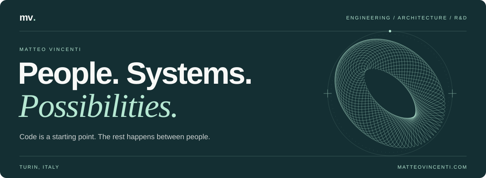

# Hi, I'm Matteo.

**Engineering Team Lead at [On Page®](https://onpage.it) · Full-stack engineer · Turin, Italy**

I build software, help teams make better technical decisions, and turn research into working products. My work spans architecture, hands-on development, and the people who keep a system moving forward.

These days, I also design **software agents, MCP servers, and AI integrations** that connect models to real application data and workflows.

**[Explore my website ↗](https://www.matteovincenti.com/en)** &nbsp; / &nbsp; **[Let's talk on LinkedIn ↗](https://www.linkedin.com/in/matteo-vincenti/)**

---

### Where I put my energy

- **Engineering leadership.** Share the reasoning, make the constraints clear, and give people room to own decisions. The best idea doesn't have to be mine.
- **Software architecture.** Build modular systems that people can understand, maintain, and change. Weigh performance against complexity and the work a decision creates later.
- **Research & development.** Start with a useful question, run a focused experiment, and let the result decide what comes next.

### Agents that work with real software

I work on the connections between **context, tools, and action**: retrieving relevant sources with RAG, exposing application capabilities through MCP, and orchestrating workflows with explicit permissions and review steps.

At On Page®, I've worked on making the PIM accessible to AI assistants through MCP.

↳ **[Read about the integration](https://onpage.it/blog/saas-compatibile-con-mcp-come-on-page-integra-lai-nel-pim/)** · Article in Italian

### Things you can open and read

<table>
  <tr>
    <td valign="top" width="50%">
      <h3><a href="https://github.com/MatteoVincenti/log-service-js">01 / LogService ↗</a></h3>
      
A TypeScript logging library with pluggable strategies and providers. Choose when logs are emitted and where they go.

      
<code>TypeScript</code> <code>Extensibility</code> <code>Developer tooling</code>

    </td>
    <td valign="top" width="50%">
      <h3><a href="https://github.com/MatteoVincenti/pi-system-monitor">02 / Pi System Monitor ↗</a></h3>
      
A Docker-based monitoring setup for Raspberry Pi and Linux, bringing together metrics, dashboards, and alerting.

      
<code>Docker</code> <code>Grafana</code> <code>Observability</code>

    </td>
  </tr>
</table>

### Tools I work with

| Layer | Tools |
| :--- | :--- |
| Interfaces | TypeScript · React · Next.js |
| Services | Node.js · PHP · Laravel · Symfony |
| Infrastructure | Docker · AWS · Linux |
| Agents & integrations | MCP · RAG · Workflow orchestration |

---

**Context first. Then the choice.**

More about my work, my approach, and what I'm exploring → **[matteovincenti.com](https://www.matteovincenti.com/en)**
